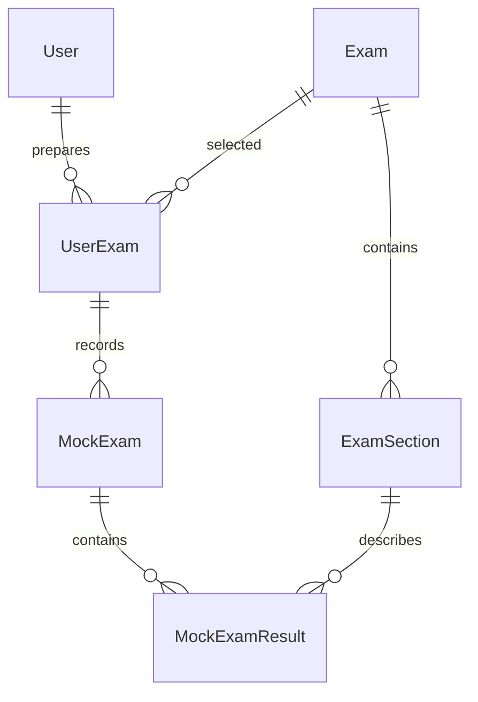

# Mimari — Faz 1–5

## Katmanlar ve kapsam
Api → Application + Infrastructure; Infrastructure → Application → Domain. Domain bağımsızdır. Application okuma DTO'larını içerir; API sorguları EF ile doğrudan DTO projeksiyonu yapar. Generic repository/CQRS eklenmedi. Faz 1 sağlık, CORS, Swagger, hata işleme ve Flutter korunur. Auth Faz 3 ile eklenmiştir; deneme/katalog yazma API'leri yoktur.

## Model
| Entity | Amaç |
| --- | --- |
| User | Gelecekteki hesap; Email, NormalizedEmail, DisplayName, nullable PasswordHash |
| Exam | Veriyle tanımlanan aktif/pasif sınav türü |
| ExamSection | Sınırsız sayıda bölüm, isteğe bağlı GroupCode/GroupName, soru sayısı ve bölen |
| UserExam | Kullanıcının hazırlığı, hedef neti, sınav tarihi |
| MockExam | Hazırlığa ait deneme, adı, UTC zamanı ve notu |
| MockExamResult | Bölüm bazında doğru/yanlış/boş sayıları ve kural snapshot'ı |

Kimlikler uygulamada Guid, PostgreSQL'de uuid; seed kimlikleri sabittir. Enum/sınav adına göre iş mantığı yoktur. TYT/AYT basit grup alanlarıyla temsil edilebilir. Yeni sınav/bölüm eklemek şema değişikliği gerektirmez.

Aynı kullanıcı için aynı/farklı sınavlarda birden fazla hazırlık mümkündür. Faz 5 ile kullanıcı başına en fazla bir aktif hazırlık, transaction ve unique partial index ile zorunludur; yeni hazırlık eskisini pasifleştirir, geçmiş silinmez. Hedef net üst sınırı yalnızca tam olarak işaretlenmiş, gruplandırılmamış ve tüm bölümleri aktif kataloglarda soru sayısından türetilir. Eksik katalogda üst sınır bilinmiyor kabul edilir. Detaylar: [hazırlık ve onboarding](preparation-onboarding.md).

## Net hesabı
NetCalculator: correct - wrong / penaltyDivisor. decimal kullanılır; erken yuvarlama yoktur. .NET decimal 28–29 anlamlı basamak hassasiyetine sahiptir; 1/3 gibi bölmeler bu sınırdadır. Negatif net geçerlidir. Sunum yuvarlaması ileride ayrı uygulanabilir.

Sayımlar negatif olamaz, toplam soru sayısını aşamaz; eşitlik zorunlu değildir (kısmi giriş mümkün). Toplam long/bigint ile kontrol edilerek int taşması önlenir. Soru sayısı ve bölen pozitiftir.

Bölen numeric(10,4), hedef numeric(12,4). Domain, ölçeğe sığmayan değeri yuvarlamak yerine reddeder. Bölen 0.0001–999999.9999, hedef 0–99999999.9999 aralığındadır. Yalnızca pozitif bölenli kural uygulanır; farklı puanlama kuralları gerektiğinde merkezi hesaplayıcı genişletilir. YDS'ye varsayılan /4 atanmaz.

MockExamResult kurucusu sunucuda yüklenen ExamSection'dan QuestionCountSnapshot ve PenaltyDivisorSnapshot alır. Özel setter'lar ve SetAnswers metodu sayesinde cevap güncellemesi kuralı değiştirmez. Bölüm kuralları sonradan değişse de eski netler korunur. Gelecekteki yazma DTO'ları snapshot veya net alanlarını istemciden almamalıdır.

Net hesaplanan, EF tarafından eşlenmeyen özelliktir. Net/TotalNet sütunu yoktur. Toplam gerektiğinde ilgili sonuçların netleri toplanarak elde edilir; tüm sonuçları yüklemek ve eksik giriş durumunu ayırt etmek gelecekteki sorgunun sorumluluğudur.

## Kısıtlar ve silme
- UNIQUE: Exam.Code; (ExamId, ExamSection.Code); User.NormalizedEmail; (MockExamId, ExamSectionId).
- Kodlar trim + ToUpperInvariant ile normalize edilir. Email trim edilir, NormalizedEmail invariant büyük harftir. Gelecekte email değişikliği ve auth aynı stratejiyi kullanmalıdır. Email doğrulama, sahiplik ve uluslararası adres politikası auth fazına aittir. PasswordHash null olan kayıt giriş yapabilen hesap değildir; hiçbir mevcut DTO hash içermez.
- CHECK: pozitif soru sayısı/bölen; negatif olmayan sayımlar/hedef; sonuç toplamı snapshot soru sayısını aşamaz; grup kodu/adı birlikte bulunur veya birlikte null olur.
- Composite FK: MockExam(UserExamId, ExamId) → UserExam(Id, ExamId). MockExamResult(MockExamId, ExamId) → MockExam(Id, ExamId), ayrıca (ExamSectionId, ExamId) → ExamSection(Id, ExamId). Alternatif anahtarlar ve ek ExamId, yanlış sınav eşleşmesini veritabanında engeller.
- Tüm foreign key'ler RESTRICT: User→UserExam, Exam→UserExam/ExamSection, UserExam→MockExam, MockExam/ExamSection→MockExamResult. Bağımlısı olan satır silinemez; cascade yoktur. Hesap silme/anonimleştirme ileride açık bir iş akışı olacaktır.
- Aktiflik/sıra, kullanıcı/aktif hazırlık, hazırlık/deneme zamanı ve FK sorguları için indeksler bulunur.
- Doğrudan SQL kullanan bakım süreçleri normalizasyon, UTC, snapshot ve audit kurallarını korumalıdır; domain korumaları SQL bakım yetkisini sınırlamaz.

## Zaman
CreatedAtUtc/UpdatedAtUtc SaveChanges ve SaveChangesAsync sırasında sunucuda UTC atanır. Oluşturma zamanı güncellemede korunur; UpdatedAtUtc ilk kayıtta null'dır. PostgreSQL tipi timestamptz. TakenAtUtc gerçek bir anı temsil eder, kurucu DateTimeKind.Utc ister. İstemci ileride yerel saati offset ile UTC'ye çevirmelidir; yalnızca tarih biliniyorsa rastgele saat varsayılmamalıdır.

ExamDate DateOnly/date türünde takvim günüdür; saat dilimi dönüşümü yoktur. Model-managed seed sabit UTC oluşturma tarihi kullanır; sonraki seed değişikliklerinde UpdatedAtUtc migration verisinde açıkça belirtilmelidir.

## Seed
ExamSeed.cs, EF HasData ile sürümlenen sistem kataloğudur. InitialDomainModel altı sınav ekler: YKS, KPSS, ALES, DGS, MSÜ (makine kodu MSU), YDS. Sabit kimlik/zaman ve migration history ikinci database update çağrısında tekrar kayıt oluşmasını önler. İdempotent SQL script üretilebilir. Uygulama açılışında otomatik migration/seed yoktur.

ALES SAYISAL/SOZEL bölümleri 50'şer soru ve bölen 4 ile eklenir. Kaynak: [ÖSYM 2026 ALES kılavuzu](https://dokuman.osym.gov.tr/pdfdokuman/2026/ALES-2/kilavuz_ales2d10062026.pdf), 3.1 ve 3.9 (basılı s.15/s.23). Hesap ham nettir, resmî standart/ağırlıklı ALES puanı değildir.

YKS TYT/AYT, KPSS alt türleri, DGS, MSÜ, YDS detayları bu teslimde doğrulanmadığından boş bırakıldı. Aktif sınav kaydı tüm detayların hazır olduğu anlamına gelmez; sections boş liste dönebilir. Onboarding öncesi ilgili yıl/alt tür, sayılar ve kurallar resmî kılavuzlarla doğrulanmalıdır.

Güncelleme: ExamSeed'i düzenleyin, aynı kimlikleri koruyun, EF ile yeni migration üretip inceleyin. Tarihsel satırları silmek/kimlik değiştirmek yerine pasifleştirin. Katalog bakımında sürümlenen seed tek kaynak olmalıdır; manuel değişikliklerle çakışabilir. Yeni sınav ekleyen migration yalnızca veri işlemleri içerebilir, şema değişmez.

## Salt okunur API
- GET /api/exams: aktif sınav DTO listesi.
- GET /api/exams/{id}: aktif sınav DTO'su; eksik/pasif/geçersiz Guid için 404.
- GET /api/exams/{id}/sections: aktif sınavın aktif bölümleri; eksik/pasif ebeveyn 404; boş bölüm listesi 200 ve [].

Listelerde SortOrder ardından Code artan sırası sözleşmedir. AsNoTracking, async ve CancellationToken kullanılır; entity serileştirilmez. Yazma endpoint'i yoktur. Bağlantı/migration olmadan katalog sorgusu genel 500 döner; sağlık veritabanından bağımsızdır.

## Doğrulama sınırı
SQLite yalnızca izole ilişkisel test sağlayıcısıdır. FK/unique/CHECK davranışları çalıştırılır; PostgreSQL migration uygulaması, numeric ölçeği veya UTC sürücü davranışını kanıtlamaz. Bu ortamda Docker motoruna erişilemedi. Canlı migration ve seed kontrolü README adımlarıyla tamamlanmalıdır.

## Faz 3 kimlik doğrulama
User artık yerleşik hasher ile üretilmiş parolayı saklar. RefreshToken ayrı tablo olarak User'a RESTRICT ile bağlanır; önceki domain ilişkileri değişmez. JWT/Bearer, DTO uç noktaları, oturum ailesi rotation/replay kilitlemesi ve hız sınırı için [authentication.md](authentication.md) belgesine bakın. Email biçimi auth katmanında doğrulanır; email sahiplik doğrulaması ve parola sıfırlama henüz yoktur. Flutter aynı kalmıştır.

## Faz 6 — deneme aggregate işlemleri

Application MockExams request/DTO/service sözleşmelerini; Infrastructure MockExamService sahiplik sorguları, snapshot hesabı ve transaction'ları; Api MockExamEndpoints HTTP durumlarını yönetir. Aktif hazırlık sunucudan çözülür, liste sayfalıdır. Detail/edit/delete sahiplik kontrolü eski hazırlıklara ait doğrudan erişimde de uygulanır. Deneme ve çocukları açık transaction ile silinir; tüm RESTRICT FK'lar korunur.

Mevcut soru/bölen snapshot'larına bölüm adı/kodu, grup adı/kodu ve sıra snapshot'ları eklendi. Net/TotalNet persist edilmez; yeni API skorları decimal metni olarak gönderir. Tarih DateOnly API, mevcut UTC sütunda günün 00:00 kodlamasıdır. Flutter repository, history/detail/draft provider'ları ve mutation controller ile çalışır; net hesabı yapmaz. Başarılı mutasyon ilgili cache'leri yeniler, oturum/hazırlık değişimi eski veriyi geçersiz kılar.

Ayrıntılı sözleşme ve kararlar: [mock-exam-tracking.md](mock-exam-tracking.md). Dashboard, grafik ve alt gezinme bu faza dahil değildir.

## Faz 7 — dashboard

Application Dashboard DTO/service sözleşmesi, Infrastructure DashboardService ve Api DashboardEndpoints eklenmiştir. Tek endpoint üç scalar sorgu ile aktif hazırlığın tutarlı görüntüsünü okur. Sonuçlar mevcut NetCalculator üzerinden streaming decimal aggregate'e girer; entity graph yüklemesi/N+1 yoktur. PostgreSQL RepeatableRead kullanılır. Yeni persist edilen istatistik veya migration yoktur.

Flutter DashboardRepository + oturum/hazırlık bağımlı autoDispose FutureProvider kullanır. Mock create/edit/delete yalnız ilgili cache'leri invalidate eder. Home Material 3 kartları, özel düz çizgili grafik ve Semantics ile server verisini sunar. Double yalnız piksel geometrisindedir. Kesin istatistik ve performans kararları [dashboard-statistics.md](dashboard-statistics.md) içinde açıklanır.

## Faz 8 — gelişmiş istatistikler

Application Statistics DTO/service sözleşmesi, Infrastructure StatisticsService ve Api StatisticsEndpoints eklenmiştir. Mevcut veriden türetilir; şema/seed/migration değişmez. Aktif hazırlık + sayı + katalog + sınırlı deneme/sonuç akışı olmak üzere dört scalar SELECT tutarlı PostgreSQL RepeatableRead transaction'ında çalışır. Deneme sınırı join öncesindedir. NetCalculator ve dashboard ile paylaşılan DecimalAggregate tek decimal hesaplama kaynağıdır; ayrı Flutter/SQL formülü yoktur.

İstatistikler ayrı `/statistics` rotasındadır. Range family FutureProvider eski filtre/oturum yanıtlarını ayırır. MockMutationController merkezi invalidation'ı genişletir. NetTrendChart opsiyonel hedefle tekrar kullanılır; erişilebilir cevap çubukları ve tarihsel cevap listesi eklenir. Detaylar [advanced-statistics.md](advanced-statistics.md), güncel gerçek PostgreSQL doğrulaması [phase8-validation.md](phase8-validation.md) içindedir. Önceki fazların Docker erişim kısıtı bu doğrulamada geçerli değildir.

## Faz 9 — mobil sunum katmanı

`core/theme/design_tokens.dart` ölçü/radius değerlerini, `AppTheme` semantic renk ve component stillerini, `core/widgets/app_components.dart` sunum bileşenlerini toplar. Feature ekranları provider/repository ve route kararlarını sahiplenmeye devam eder; ortak UI katmanı veri erişimi veya business formülü içermez. `NetPusulaApp` sistem açık/koyu temasını ve status-bar kontrastını uygular.

Backend/API/model/migration, Flutter data/domain/provider/routing ve decimal formatter değişmez. Mevcut chart painter'ı yalnız hafif kılavuz ve single-point açıklamasıyla güncellenir. Tasarım kararları: [design-system.md](design-system.md); test/visual kanıt: [phase9-validation.md](phase9-validation.md).

## Faz 10 — güvenlik ve hata dayanıklılığı

Development dışında ConnectionStrings:Database startup options validation ile denetlenir. Mock list/detail çoklu SELECT'leri dashboard/statistics gibi PostgreSQL RepeatableRead transaction'ına alındı; endpoint/DTO/model değişmedi. Global exception handler application/problem+json döndürür.

AuthInterceptor başarılı ve hatalı HTTP yanıtlarında oturum generation sınırını denetler. Ağ okuyan beş FutureProvider varsayılan otomatik retry yerine ilk hatayı UI'a verir; kullanıcı retry/pull-to-refresh veya mutasyon invalidation'ı açıkça yeniden yükler. 401 single-flight/tek retry ayrı auth katmanında korunur. Yeni persistent cache yoktur. Detay: [security.md](security.md), [phase10-validation.md](phase10-validation.md).
